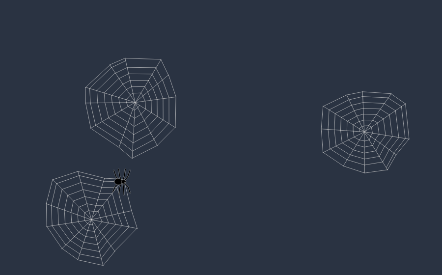

# 🕷️ Idle Spider

A tiny, elegant spider crawls onto your Linux desktop when you leave the computer idle, wanders
around and slowly weaves spider webs. Move the mouse or press a key and everything fades away.
A light visual effect — not a classic screensaver.


<!-- Replace docs/preview.png with a GIF recorded on your desktop. -->

## Features

- Vector spider (8 animated legs), black by default, any color
- Organic movement: curved Bézier paths, speed changes, short "searching" pauses
- Webs are built progressively: frame → radial threads → spiral, the spider walks the thread it lays
- Several webs per idle period (configurable maximum), thin semi-transparent anti-aliased lines
- Transparent, click-through, focus-less overlay; multi-monitor (Current / All / Random)
- Tray icon, settings window, single instance, autostart, persistent JSON config
- Explicit state machine, frame-independent animation, near-zero CPU while monitoring

## Support matrix (honest version)

| Environment | Idle detection | Needs |
|---|---|---|
| X11: GNOME, KDE, XFCE, Cinnamon, MATE, … | ✅ XScreenSaver (ctypes) or `xprintidle` | `libxss1` / `libXScrnSaver` / `libxss` (or `xprintidle`) |
| GNOME Wayland | ✅ Mutter `IdleMonitor` over D-Bus | nothing |
| Sway, Hyprland, river, labwc, KDE Plasma 6\*, COSMIC | ✅ `ext-idle-notify-v1` via `swayidle` | `swayidle` |
| Other Wayland compositors | ⚠️ No automatic trigger; manual/test mode only, with a clear message | – |

\*Reported to implement `ext-idle-notify-v1`; the backend is verified at runtime, not assumed.
**Wayland does not allow clients to read global idle time**, so there is no universal solution.
See [docs/WAYLAND.md](docs/WAYLAND.md). If automatic detection is impossible the app never
crashes: it logs why, tells you in the tray, and still lets you run the effect manually.

> Tested in development: all core logic (unit tests), Qt offscreen rendering, the CLI, single
> instance handling and the fallback path. Real X11/Wayland desktops, tray behaviour and
> click-through stacking depend on your compositor – please report issues with `--debug` logs.

## Installation

```bash
# system packages (pick your distro)
sudo apt install libxss1 libxcb-cursor0 swayidle      # Debian/Ubuntu (swayidle: wlroots/KDE6 only)
sudo dnf install libXScrnSaver xcb-util-cursor swayidle
sudo pacman -S libxss xcb-util-cursor swayidle

git clone https://github.com/<you>/idle-spider.git
cd idle-spider
python3 -m venv .venv
source .venv/bin/activate
pip install -r requirements.txt
PYTHONPATH=src python -m idle_spider        # or: pip install -e .  then  idle-spider
```

Recommended: `pipx install .` (puts `idle-spider` in `~/.local/bin`), then `./scripts/install-user.sh`
for the menu entry and icon.

**GNOME** has no tray by default: install the *AppIndicator and KStatusNotifierItem Support*
extension, or use `idle-spider --no-tray` and control it with `idle-spider --settings` / `--quit`.

### Autostart

- *Settings → Start with system* writes `~/.config/autostart/idle-spider.desktop`, **or**
- systemd user service: `cp packaging/idle-spider.service ~/.config/systemd/user/ && systemctl --user enable --now idle-spider`

## Usage

```bash
idle-spider                 # run in background (tray)
idle-spider --settings      # open settings (also forwards to the running instance)
idle-spider --test          # 20 s demo animation
idle-spider --no-tray       # headless
idle-spider --debug         # verbose logs
idle-spider --timeout 120   # idle timeout for this run only
idle-spider --quit          # stop the running instance
idle-spider --native-wayland  # force Qt's native Wayland overlay (see docs/WAYLAND.md)
idle-spider --help
```

Tray menu: Enable/Disable · Settings · Pause · Resume · Start Animation Now · Stop Animation ·
Test Animation (20 s, ignores input so you can watch it) · Reset · Quit.

## Configuration

`~/.config/idle-spider/config.json` (edited by the settings window; invalid values are repaired):

```json
{
  "enabled": true, "idle_timeout": 60,
  "spider_color": "#000000", "web_color": "#bdbdbd", "web_opacity": 0.55,
  "spider_size": 14, "animation_speed": 1.0, "web_density": 5, "max_webs": 4,
  "start_corner": "top_left", "monitor_mode": "current", "autostart": false
}
```

`start_corner`: top_left | top_right | bottom_left | bottom_right | random ·
`monitor_mode`: current | all | random. Logs: `~/.local/state/idle-spider/idle-spider.log`.

## Troubleshooting

| Symptom | Fix |
|---|---|
| `Could not load the Qt platform plugin "xcb"` | `sudo apt install libxcb-cursor0` (Qt ≥ 6.5) |
| "Idle detection is unavailable" | Install `libxss1`/`xprintidle` (X11) or `swayidle` (Wayland), or log into X11 |
| No tray icon on GNOME | Install the AppIndicator extension, or `--no-tray` |
| Spider appears under some windows | Compositor stacking policy; try `--native-wayland` or an X11 session |
| Fires while you work | Check `--debug`; if the backend is a fallback it never auto-triggers |
| Nothing visible | Run `idle-spider --test --debug` and check the log |

## Development

```bash
pip install -e ".[dev]"
QT_QPA_PLATFORM=offscreen pytest -q
ruff check src tests
```

Layout: see [docs/ARCHITECTURE.md](docs/ARCHITECTURE.md).

## Build

```bash
python -m build            # sdist + wheel in dist/
./packaging/appimage/build.sh   # EXPERIMENTAL AppImage via python-appimage
```

## Contributing / License

See [CONTRIBUTING.md](CONTRIBUTING.md). Released under the [MIT License](LICENSE).
